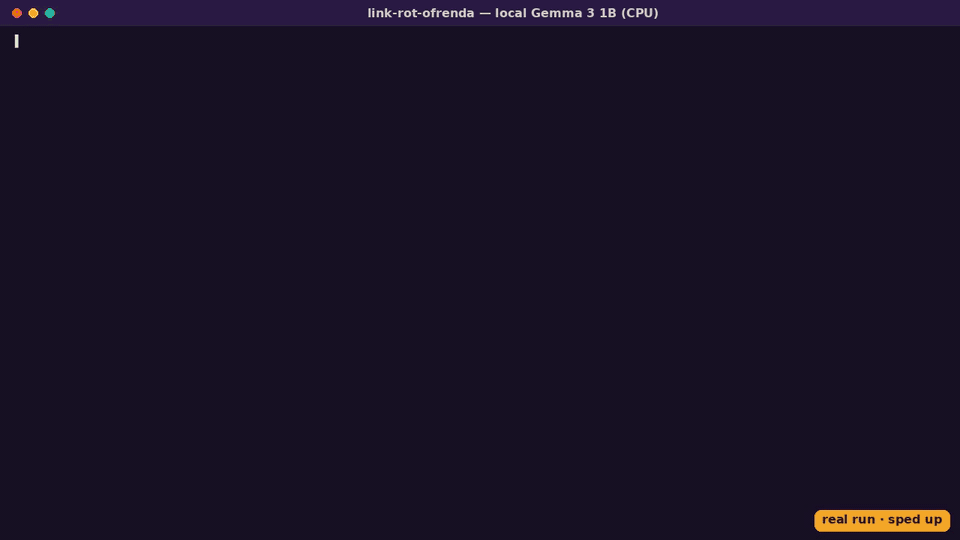

# 🌼 Link Rot Ofrenda

**An offline ofrenda for web pages that died.** Give it a list of dead links (old bookmarks, the links in your 2009 blog posts) and it finds each page's last good snapshot in the Internet Archive, recovers the text, and asks a small open-weight model running on your own machine (Gemma 3 1B by default) to write a short epitaph and summary. Then it lays them out on a marigold-and-candlelight altar: one static HTML file.

It also refuses to make things up. If the archive never saw a page, its candle stays unlit and nothing is written. If the model's summary drifts away from the archived text, the summary is withheld and the page speaks in its own words instead.



**Live demo:** the ofrenda in [`docs/index.html`](docs/index.html) was generated by a real run on [`examples/lost-links.txt`](examples/lost-links.txt) (terminal output in [`examples/sample-run.txt`](examples/sample-run.txt)). Enable GitHub Pages on `/docs` to serve it.

## 🕯️ Otari edition (branch `otari-wilding`)

This branch was built for Mozilla.ai's [Developers Wilding: Online](https://otari.ai/devs-wilding) hackathon. It adds a second backend: instead of one small local model, a small team of **open-weight models reached through [Otari](https://otari.ai)** ([source](https://github.com/mozilla-ai/otari)), Mozilla.ai's open-source AI gateway. The principle is unchanged and actually stricter: **nothing on the altar is written from a model's memory.** Every model has one job, and every answer it gives is checked by something that is not that model.

```sh
export OTARI_API_KEY=otk_...        # workspace key from otari.ai → API keys (never written to disk)
python -m ofrenda examples/lost-links.txt --backend otari -o docs/otari/index.html
```

**Demo video (3:53):** https://drive.google.com/file/d/1YGiDak14xzMmNkvqbhVJZSE3auj4sxN-/view?usp=sharing

Result of a real run: [`docs/otari/index.html`](docs/otari/index.html) (terminal output in [`examples/otari-run.txt`](examples/otari-run.txt), per-call ledger in [`docs/otari/otari-ledger.json`](docs/otari/otari-ledger.json)). A fresh run of the 10 sample links (nothing cached) made 26 gateway calls and cost $0.084, most of it the flat fee for each web search; a re-run that reuses the cached, already-verified search results made 20 calls and cost $0.012.

### Who does what

| Role | Default model (open weights) | Otari feature | Why it cannot make things up |
|---|---|---|---|
| **Scribe**: epitaph, summary, offering | `epitaph-chain` policy → Gemma 3 27B, then Mistral Small; client-side chain falls back to `google/gemma-3-27b-it`, `mistralai/ministral-3-14b` | Routing policy with fallbacks, plus Otari's automatic provider fallback; the client walks the rest of the chain | Sees only the recovered archive text; the lexical guard and the witness below decide whether its summary is shown |
| **Witness**: re-reads each summary | `alibaba/qwen3-30b-a3b-instruct-2507` (a different lab from the scribe) | Multiple models in distinct roles | Can only remove words: it lists unsupported phrases, and an objection that does not quote the summary is ignored |
| **Archivist**: where does the story live now? | `alibaba/qwen3-235b-a22b-instruct-2507` | Built-in `otari_web_search` (run by the gateway) | It may choose links but not write them: a URL is kept only if it is in the `otari_tool_calls` sources Otari returned for that request, and the card shows the search result's own title |
| **Archivist, second route**: snapshot lookup when the Wayback CDX API fails | same | MCP: a public, keyless [Internet Archive MCP server](https://github.com/cyanheads/internet-archive-mcp-server), attached inline with `mcp_servers` | The MCP answer is a lead: the snapshot is used only after we fetch it from web.archive.org ourselves |
| **Reckoner**: how long was each page archived? | `openai/gpt-oss-120b` | Built-in `otari_code_execution` sandbox | It must compute the spans in Python; we recompute every number locally and print only the ones that match |
| **Budget** | — | Workspace budget + spend ceiling ($1.50/month on our workspace) and per-call `cost_usd` | `--max-spend` (default $0.25) caps a run; when either limit is hit the remaining cards get the page's own words and no model text, instead of crashing or routing around the limit |

Every card says which model and provider wrote it ("written by google/gemma-3-27b-it on nebius via Otari · checked by Qwen3-30B"), taken from Otari's `Otari-Model` / `Otari-Provider` / `Otari-Fallback` response headers. Requests carry `metadata` tags (`app`, `role`) and a `session_label`, so Otari's usage view can split spend by role.

### Did the witness earn its place?

The original README admits that local Gemma 3 1B wrote "explains the reasons behind the decision" for the Google Reader page, which only links to a blog post. [`scripts/witness_replay.py`](scripts/witness_replay.py) replays the Otari witness over that old [`docs/ofrenda.json`](docs/ofrenda.json): it flags exactly that phrase and passes the other seven summaries ([`examples/witness-replay.txt`](examples/witness-replay.txt)). The first version of the witness prompt missed it; the prompt now says a heading, a question or a link is not the content itself.

### Useful flags (Otari backend)

`--scribe-chain` (models or routing policies, in order), `--witness`, `--archivist`, `--reckoner` (each takes a model id, or `none` to switch the role off), `--lookup mcp` (ask the MCP server before CDX), `--ia-mcp URL`, `--max-spend USD`. If the `epitaph-chain` policy does not exist in your workspace, the client simply falls through to the next model. Create your own under Routing → Policies in the Otari dashboard, and allow web access under Tools → Web search.

### What we did not use, and why

- **Guardrails:** the hosted guardrail catalog needs a third-party vendor API key, and there is no keyless open-weight option yet ([mozilla-ai/otari#2722](https://github.com/mozilla-ai/otari/issues/2722)). Our "guardrail" is the witness, which runs in the app.
- **Per-user budgets:** they need service keys with end-user budgets. This is a single-user CLI, so there is no honest use for them here.

### AI-assisted development

This branch was developed with AI assistance. An AI agent working for the maintainer wrote most of the Otari integration, the tests and this section, and ran every command shown. The runs, costs and outputs in this repository are real and unedited. The models named above wrote the epitaphs and summaries on the altar, as each card says.


## How it works

```
lost-links.txt ──► liveness check ──► Wayback CDX: last 200 OK capture ──► fetch original bytes (id_)
                   (cause of death)    (optionally before a "last alive" year)        │
                                                                                      ▼
docs/index.html ◄── render altar ◄── grounding guard ◄── local Gemma via OpenAI-compatible API ◄── extract text
                                     (withhold summary if it                (llama.cpp or Ollama)
                                      strays from the source)
```

1. **Cause of death.** DNS lookup plus an HTTPS/HTTP request: "the domain no longer resolves", "the server answers HTTP 404", "now redirects to yahoo.com".
2. **Find the memory.** The Wayback Machine [CDX API](https://github.com/internetarchive/wayback/tree/master/wayback-cdx-server) returns the last capture with status 200 and type `text/html`, optionally capped at the year the site was last known alive, so you get the site and not the domain-parking page that replaced it. The [availability API](https://archive.org/help/wayback_api.php) is a fallback. No API key is needed.
3. **Recover the text.** The original bytes are fetched with the `id_` flag (no Wayback toolbar), and a stdlib HTML parser keeps titles, meta descriptions and prose.
4. **Remember it.** The model gets only the recovered text and must answer in constrained JSON (`summary`, `epitaph`, `offering`) at temperature 0.3.
5. **Check it.** A lexical grounding guard measures how many of the summary's content words appear in the source, and flags capitalised names or numbers that do not. Below 45%, or with any suspect token, it retries once at temperature 0.1. If it still fails, the summary is withheld and the card quotes the page itself.
6. **Render.** One self-contained HTML file with no JavaScript, no CDN and no tracking, plus `ofrenda.json` with everything that was produced.

## Setup

You need Python 3.10+ (standard library only, nothing to `pip install`) and a local model server.

### Option A: llama.cpp (what the demo used)

```sh
# 1. get llama-server for your platform: https://github.com/ggml-org/llama.cpp/releases
# 2. download Gemma 3 1B instruct (non-gated GGUF, ~800 MB) and start the server:
./scripts/serve_gemma.sh          # serves http://127.0.0.1:8080/v1
# 3. build the ofrenda
python -m ofrenda examples/lost-links.txt -o docs/index.html
```

### Option B: Ollama (not used for the demo run; same API)

```sh
ollama pull gemma3:1b
python -m ofrenda examples/lost-links.txt -o docs/index.html \
  --endpoint http://127.0.0.1:11434/v1 --model gemma3:1b
```

Any other OpenAI-compatible local server and any open-weight instruct model should work. Set `--model` to the name your server expects; it is also credited on the page.

## Your own lost links

One URL per line. You can add a display name and the last year the page was alive, separated by `|`:

```
http://www.pownce.com/ | Pownce | 2008
http://ffffound.com/   | FFFFOUND! | 2016
https://my-old-blog.example/2009/hello-world
```

Useful flags: `--no-liveness` (skip the live check), `--cache DIR` (archived pages and snapshot lookups are cached, so a re-run with `--no-liveness` needs no network, only the local model), `--title`, `--temperature`, `--json PATH`.

## Tests

```sh
python -m unittest discover -s tests -v
```

The tests run offline (the Otari tests use a fake client, so no key is needed). They cover the grounding guard, input parsing, JSON parsing of chatty model output, text extraction, and the "unlit candle" refusal.

## Honest limitations

- The grounding guard is **lexical**, not a fact-checker. It reliably catches invented names and numbers and summaries that wander off-topic, but a fluent paraphrase can still overstate. In the sample run, Gemma says the Google Reader page "explains the reasons behind the decision", while the page only links to a blog post for that. The guard also sometimes withholds a summary that was fine. In this project, withholding a true sentence is the cheaper mistake.
- "Address first archived" is the first capture of that URL, which can predate the site (Rdio's domain was captured in 2002, years before Rdio launched).
- A 1B model writes gentle, somewhat generic epitaphs. Larger Gemma models (4B, 12B) write better ones if your machine can run them.
- The Wayback Machine is sometimes slow or briefly unreachable. Failed fetches leave the candle unlit rather than guessing.
- The tool downloads public archived pages only. Please be kind to the Internet Archive: the cache exists so you don't fetch the same snapshot twice.

## Credits and licences

- Code: MIT (see [LICENSE](LICENSE)).
- Model: [Gemma 3 1B instruct](https://huggingface.co/ggml-org/gemma-3-1b-it-GGUF) by Google DeepMind, under the [Gemma Terms of Use](https://ai.google.dev/gemma/terms). The weights are not included in this repo.
- Inference: [llama.cpp](https://github.com/ggml-org/llama.cpp) (MIT).
- Memories: the [Internet Archive's Wayback Machine](https://web.archive.org/). If this made you smile, [consider donating to them](https://archive.org/donate).

Built for the DEV Hacktoberfest Open-Source AI Challenge, Week 4: *Ghost in the Machine*.
